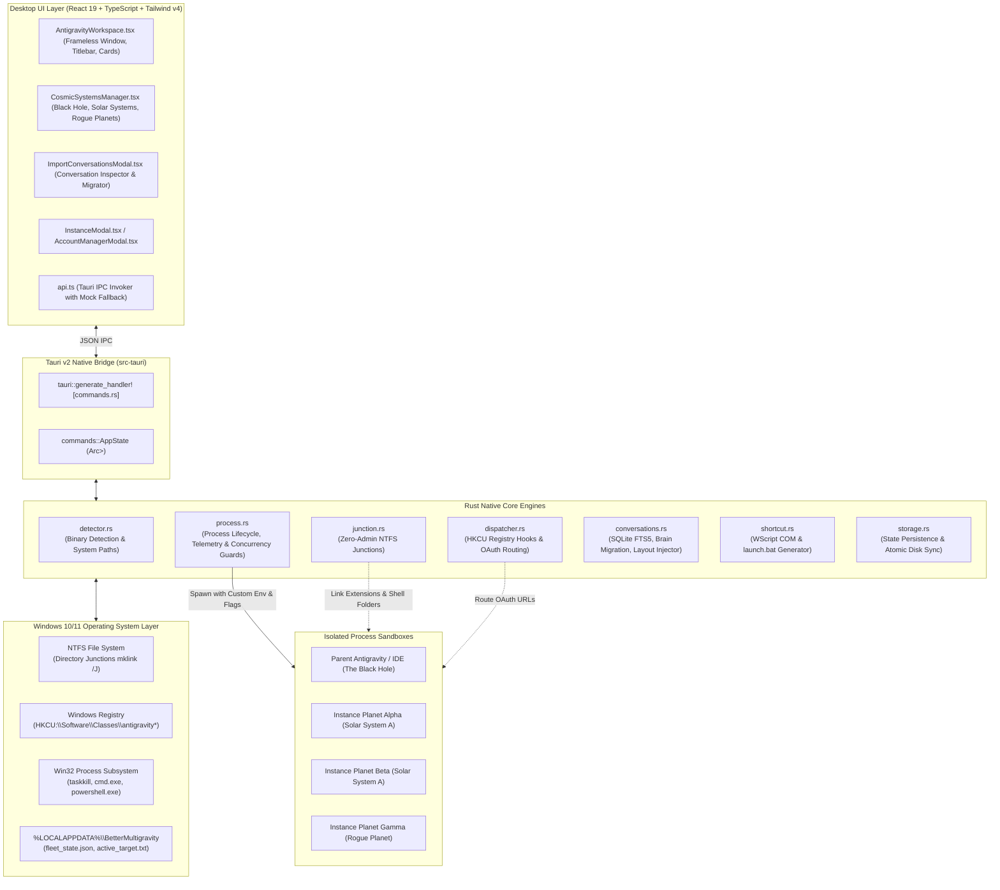
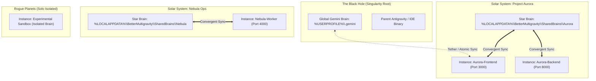
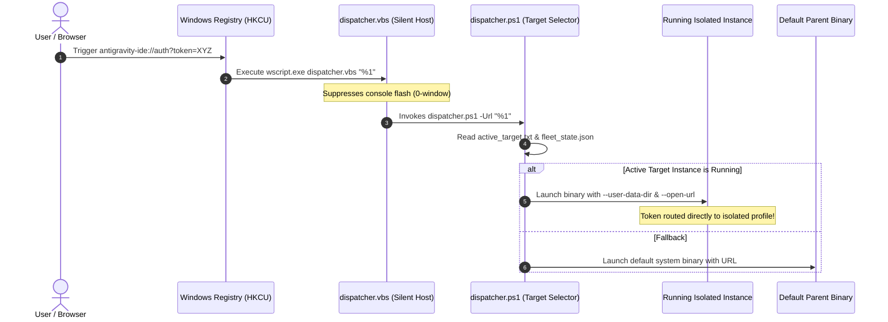
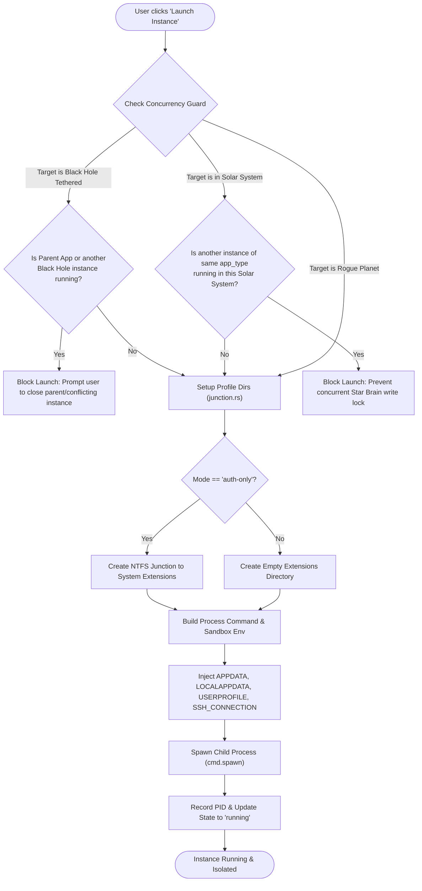

# OrbitGravity — Exhaustive Technical Architecture & Implementation Guide 🪐⚡

> **The Definitive Internal Engineering Specification for OrbitGravity (BetterMultigravity)**  
> *Deep-dive documentation covering Windows Process Isolation, Zero-Elevation NTFS Junctions, Cosmic Systems Memory Architecture, Protocol Dispatching, Conversation Migration Engines, and Native Win32 Integration.*

---

## Table of Contents
1. [Executive Summary & Core Engineering Philosophy](#1-executive-summary--core-engineering-philosophy)
2. [End-to-End System Architecture](#2-end-to-end-system-architecture)
   - [Architectural Topology Diagram](#architectural-topology-diagram)
   - [Technology Stack Breakdown](#technology-stack-breakdown)
3. [Deep-Dive Feature Implementations](#3-deep-dive-feature-implementations)
   - [Feature 1: Multi-Instance Sandboxing & Process Isolation](#feature-1-multi-instance-sandboxing--process-isolation)
   - [Feature 2: Zero-Elevation NTFS Directory Junctions](#feature-2-zero-elevation-ntfs-directory-junctions)
   - [Feature 3: Cosmic Systems Architecture (Memory & Convergence)](#feature-3-cosmic-systems-architecture-memory--convergence)
   - [Feature 4: Protocol Dispatcher & Browser OAuth Interception](#feature-4-protocol-dispatcher--browser-oauth-interception)
   - [Feature 5: Conversation Migration & Brain Asset Synchronization](#feature-5-conversation-migration--brain-asset-synchronization)
   - [Feature 6: Parent Binaries Multi-Executable Switcher](#feature-6-parent-binaries-multi-executable-switcher)
   - [Feature 7: Windows Shortcut Generator & Headless Scripts](#feature-7-windows-shortcut-generator--headless-scripts)
   - [Feature 8: Real-Time Quota Telemetry & Account Orchestration](#feature-8-real-time-quota-telemetry--account-orchestration)
   - [Feature 9: Native Win32 Shell Polish & Icon Embedding](#feature-9-native-win32-shell-polish--icon-embedding)
4. [Process Lifecycle & Concurrency State Machines](#4-process-lifecycle--concurrency-state-machines)
   - [Instance Launch Flowchart](#instance-launch-flowchart)
   - [Mutual Exclusion & Concurrency Guard](#mutual-exclusion--concurrency-guard)
5. [Data Schemas & Persistence Models](#5-data-schemas--persistence-models)
   - [Rust State Structures (`fleet_state.json`)](#rust-state-structures-fleet_statejson)
   - [VS Code Storage & SQLite Schema (`state.vscdb` / `conversations.db`)](#vs-code-storage--sqlite-schema-statevscdb--conversationsdb)
6. [Automated Verification & Test Harness](#6-automated-verification--test-harness)
   - [Backend Rust Unit & Integration Tests (35/35 passing)](#backend-rust-unit--integration-tests-3535-passing)
7. [Caveats, Edge Cases & Failure Recovery](#7-caveats-edge-cases--failure-recovery)

---

## 1. Executive Summary & Core Engineering Philosophy

Google Antigravity (and its VS Code / Electron underpinnings) is built upon a single-instance architecture. By default:
- All running windows bind to a shared `%APPDATA%`, `%LOCALAPPDATA%`, and `%USERPROFILE%`.
- Electron and VS Code listen on local IPC pipes or single-instance mutexes.
- Clicking an external link or OAuth redirect triggers the running primary instance to absorb the URL, stealing session tokens.
- Symbolic linking (`mklink /D`) on Windows requires elevated Administrator privileges or Windows Developer Mode, creating massive friction in enterprise or standard user environments.

**OrbitGravity** fundamentally solves these challenges on Windows with zero administrative elevation by uniting:
1. **NTFS Directory Junctions (`mklink /J`)**: OS-level directory pointers that bypass Windows privilege checks.
2. **Aggressive Environment Variable & CLI Flag Sandboxing**: Rewriting process-level environment blocks and passing explicit `--user-data-dir` and `--extensions-dir` flags.
3. **The `SSH_CONNECTION` Mutex Defeat**: Tricking VS Code's process launcher into treating each instance as a discrete remote session, bypassing the single-instance IPC bridge.
4. **Cosmic Systems Topology**: Hierarchical clustering of memory (The Black Hole singularity, Solar Systems with shared Star Brains, and isolated Rogue Planets).
5. **A Non-Intrusive Registry Dispatcher**: Intercepting `antigravity://` and `antigravity-ide://` OAuth protocol redirects in user space (`HKCU`) without administrative elevation.

---

## 2. End-to-End System Architecture

### Architectural Topology Diagram



### Technology Stack Breakdown

| Layer | Technologies | Responsibilities |
| :--- | :--- | :--- |
| **Frontend Framework** | React 19, TypeScript, Vite 6 | High-performance reactive UI rendering, responsive state management. |
| **Styling & Icons** | Tailwind CSS v4, Lucide React | Space-themed dark palette (`#06080e`, `#0c1017`), custom glows, smooth transitions. |
| **Desktop Runtime** | Tauri v2.12 (`app_lib`) | Lightweight native Windows container, minimal memory footprint (<35MB idle). |
| **Native Backend** | Rust 2024 Edition (v1.90+) | File manipulation, process management, SQLite transactions, Windows API calls. |
| **System Automation** | PowerShell, VBScript, WScript COM | Seamless shortcut creation, quiet registry protocol interception without flashing terminal windows. |
| **Data Engine** | SQLite3, Rusqlite, Serde JSON | High-fidelity atomic conversation parsing, FTS5 table indexing, state persistence. |

---

## 3. Deep-Dive Feature Implementations

### Feature 1: Multi-Instance Sandboxing & Process Isolation

#### The Challenge
When launching multiple instances of an Electron/Chromium-based application like Antigravity, the secondary instance detects the primary's named pipe or shared memory and delegates its startup parameters to the existing window. Furthermore, VS Code shares credentials stored in the Windows Credential Manager or `%APPDATA%\Code\User`.

#### The Implementation
OrbitGravity isolates instances completely at launch via [`src-tauri/src/process.rs`](./src-tauri/src/process.rs):

1. **CLI Flag Injection**:
   ```rust
   cmd.arg(format!("--user-data-dir={}", data_dir.display()))
      .arg(format!("--extensions-dir={}", extensions_dir.display()))
      .arg("--new-window");
   ```
2. **Environment Variable Redirection**:
   Every child process receives an isolated environment block:
   ```rust
   cmd.env("APPDATA", roaming_dir.as_os_str())
      .env("LOCALAPPDATA", local_dir.as_os_str())
      .env("USERPROFILE", profile_path.as_os_str())
      .env("SSH_CONNECTION", "127.0.0.1 1234 127.0.0.1 22")
      .env("BETTERMULTIGRAVITY_INSTANCE_ID", &instance.id)
      .env("BETTERMULTIGRAVITY_PORT", instance.port.to_string());
   ```
3. **The `SSH_CONNECTION` Trick**:
   VS Code inspects whether it is running within an SSH or remote tunnel session. By injecting a synthetic `SSH_CONNECTION` variable (`127.0.0.1 1234 127.0.0.1 22`), the internal single-instance socket listener is bypassed, allowing two identical binaries to run simultaneously side-by-side.
4. **Shell Folder Bridging**:
   When `USERPROFILE` is altered, Windows file pickers (Open Folder, Save As) fail if `Desktop`, `Documents`, or `Downloads` do not exist. [`junction.rs`](./src-tauri/src/junction.rs) bridges the real user shell folders into the profile directory using NTFS Junctions.
5. **Language Server & Gemini Configuration**:
   The engine links `%USERPROFILE%\.gemini\config` into `<profile>\.gemini\config`, ensuring the Antigravity language server recognizes workspace skills, rules, and telemetry configs without re-downloading them.

---

### Feature 2: Zero-Elevation NTFS Directory Junctions

#### The Challenge
Windows symbolic links (`mklink /D`) enforce strict UAC security policies. Unless the user runs as Administrator or enables Windows Developer Mode, creating a symlink returns `Error: Access is denied`.

#### The Implementation
Implemented in [`src-tauri/src/junction.rs`](./src-tauri/src/junction.rs):
- **NTFS Junctions (`mklink /J`)**: Directory junctions are NTFS reparse points designed for local drive directory redirection. Crucially, **they require zero administrative rights**.
  ```cmd
  cmd.exe /C mklink /J "<link_path>" "<target_path>"
  ```
- **Execution Modes**:
  1. `auth-only`: Links `<profile>\extensions` directly to `%USERPROFILE%\.antigravity-ide\extensions`. All installed extensions, themes, and language plugins are instantly shared. Storage footprint per profile drops from ~1.5 GB to <15 MB.
  2. `full`: Creates a completely independent physical directory for extensions.
- **Safe Unlinking**:
  To delete a junction without deleting the underlying files in the target directory, OrbitGravity uses:
  ```cmd
  cmd.exe /C rmdir "<link_path>"
  ```
  `rmdir` on an NTFS junction breaks the pointer without touching a single file in the linked target directory.

---

### Feature 3: Cosmic Systems Architecture (Memory & Convergence)

#### Conceptual Hierarchy



#### Architecture Details
1. **The Black Hole (Root Memory Singularity)**:
   - Root path: `%USERPROFILE%\.gemini` (the default unisolated Antigravity storage).
   - Tethered instances mirror and converge their conversation state with The Black Hole.
   - **Safety Lock**: Because SQLite databases cannot tolerate multiple active writers across distinct process handles, **a Black Hole instance cannot run while the Parent Antigravity app is running**. OrbitGravity enforces this with mutual exclusion guards.
2. **Solar Systems (Star Brain Sharing)**:
   - All instances within a named Solar System share a centralized **Star Brain** directory (`%LOCALAPPDATA%\BetterMultigravity\SharedBrains\<group_name>`).
   - Before launching an instance in a Solar System, OrbitGravity executes convergent file synchronization. Transcripts, media artifacts, and `.system_generated` checkpoints converge seamlessly.
3. **Rogue Planets**:
   - Completely independent instances with their own isolated memory (`<profile>\.gemini`). They never share or sync state with other instances.

---

### Feature 4: Protocol Dispatcher & Browser OAuth Interception

#### The Challenge
When a user clicks "Sign In with Google" or authorizes a third-party extension within an isolated Antigravity instance, the browser completes OAuth and fires a custom protocol redirect (`antigravity://...` or `antigravity-ide://...`). By default, Windows opens the global parent application, routing the authentication token to the wrong profile!

#### The Implementation
Implemented in [`src-tauri/src/dispatcher.rs`](./src-tauri/src/dispatcher.rs) and [`scripts/dispatcher.ps1`](./scripts/dispatcher.ps1):



#### Key Engineering Safeguards:
1. **Zero-Elevation HKCU Registration**:
   Modifications are made strictly within `HKCU:\Software\Classes\antigravity\shell\open\command` and `HKCU:\Software\Classes\antigravity-ide\shell\open\command`. **No administrator privileges are required.**
2. **Atomic Registry Backup**:
   Before modifying any registry keys, OrbitGravity captures the existing command strings and writes them to `%LOCALAPPDATA%\BetterMultigravity\registry_backup.json`.
3. **1-Click Emergency Rollback**:
   OrbitGravity generates standalone fallback scripts:
   - [`restore_original_protocols.bat`](./restore_original_protocols.bat)
   - [`restore_original_protocols.ps1`](./restore_original_protocols.ps1)
   Users can restore original system settings with a single double-click even if OrbitGravity is uninstalled.
4. **VBScript Silent Wrapper**:
   Executing PowerShell directly from a protocol handler flashes an unwanted black console window. OrbitGravity routes through `dispatcher.vbs` (`WScript.Shell.Run ..., 0, False`) to guarantee a completely invisible, smooth user experience.

---

### Feature 5: Conversation Migration & Brain Asset Synchronization

#### The Challenge
Antigravity stores conversational memories across two decoupled subsystems:
1. **Physical Filesystem**: Checkpoint files, raw prompt transcripts (`transcript.jsonl`), full context logs (`transcript_full.jsonl`), and media artifacts inside `.gemini/<app_type>/brain/<conversation_id>/`.
2. **VS Code Internal State**: SQLite databases (`state.vscdb`) storing layout panels (`antigravity-multi-conversation-layout-v3-<id>`), project links, and full-text search indexes (`fts5`).

Copying files alone results in "ghost conversations" that do not render in the UI.

#### The Implementation
Implemented in [`src-tauri/src/conversations.rs`](./src-tauri/src/conversations.rs):
- **Full Asset Copying**: Recursively transfers transcript directories, image artifacts, and `.system_generated` metadata.
- **SQLite Database Merging**:
  - Connects to source and destination SQLite databases.
  - Updates conversation records and search indexes.
  - Guarantees **anti-rollback protection**: if an instance has a newer revision of a conversation (e.g., 27 steps vs 25 steps), the engine prevents older checkpoints from overwriting newer work.
- **Layout Key Injection & Sanitization**:
  - Reads `antigravity-multi-conversation-layout-v3-index` from the source `state.vscdb`.
  - Injects the active conversation layout into the destination profile.
  - **Sanitizes forbidden keys**: Strips instance-specific identifiers like `lastCreatedProjectId`, `aux-pane-session`, and `sidebar_collapsed_sections` to prevent workspace UI corruption.

---

### Feature 6: Parent Binaries Multi-Executable Switcher

#### The Challenge
Developers often have multiple installations of Antigravity:
- Classic Desktop App: `antigravity\Antigravity.exe`
- Standalone IDE: `Antigravity IDE\Antigravity IDE.exe`
- Custom / Portable Builds: Windsurf, Cursor, or VS Code derivatives.

#### The Implementation
Implemented in [`src-tauri/src/detector.rs`](./src-tauri/src/detector.rs) & [`ParentBinariesModal.tsx`](./src/components/ParentBinariesModal.tsx):
- Auto-scans `%LOCALAPPDATA%\Programs`, `%PROGRAMFILES%`, `%PROGRAMFILES(X86)%`, and the Windows `PATH` environment via `where.exe`.
- Categorizes detected executables as `"ide"` or `"app"`.
- Allows instances to inherit the global default or configure an explicit per-instance binary override (`instance.binary_path`).

---

### Feature 7: Windows Shortcut Generator & Headless Scripts

#### The Implementation
Implemented in [`src-tauri/src/shortcut.rs`](./src-tauri/src/shortcut.rs):
1. **Isolated `launch.bat` Generator**:
   Writes a standalone batch launcher directly into the instance's profile directory:
   ```cmd
   @echo off
   title Antigravity - Profile Name
   set SSH_CONNECTION=127.0.0.1 1234 127.0.0.1 22
   set APPDATA=...
   set LOCALAPPDATA=...
   set USERPROFILE=...
   start "" "Antigravity IDE.exe" --user-data-dir="..." --extensions-dir="..." --new-window
   ```
2. **Windows Shell COM Automation (`WScript.Shell`)**:
   Generates native Windows `.lnk` shortcuts on the Desktop or Start Menu:
   - Configures `TargetPath`, `Arguments`, `WorkingDirectory`.
   - Sets `WindowStyle = 7` (Minimized launcher window).
   - Preserves the authentic Antigravity application icon by referencing the binary's icon index (`IconLocation = '<path>,0'`).

---

### Feature 8: Real-Time Quota Telemetry & Account Orchestration

#### The Implementation
Implemented in [`src-tauri/src/telemetry.rs`](./src-tauri/src/telemetry.rs) and [`AccountQuotaMonitor.tsx`](./src/components/AccountQuotaMonitor.tsx):
- Tracks monthly token consumption against tier allocations.
- Computes Request Per Minute (RPM) limits.
- Tracks daily spend against configured caps.
- Calculates total local disk storage saved by NTFS junctions (`calculate_storage_saved_mb`).
- **Dynamic Warning System**: When an account reaches >85% of its monthly token limit or RPM cap, OrbitGravity triggers real-time visual warning badges and status alerts.

---

### Feature 9: Native Win32 Shell Polish & Icon Embedding

#### The Implementation
- **Custom Frameless Titlebar**: Custom window drag regions (`data-tauri-drag-region`) paired with Rust IPC handlers (`window_minimize`, `window_toggle_maximize`, `window_close`).
- **Binary Resource Compilation**:
  [`src-tauri/build.rs`](./src-tauri/build.rs) embeds `icon.ico` directly into the Windows executable PE resource table (`resource.rc`).
  ```rust
  fn main() {
      println!("cargo:rerun-if-changed=tauri.conf.json");
      println!("cargo:rerun-if-changed=icons/icon.ico");
      println!("cargo:rerun-if-changed=icons/32x32.png");
      println!("cargo:rerun-if-changed=icons/128x128.png");
      tauri_build::build()
  }
  ```
- **Runtime Win32 Icon Dispatch**:
  In [`src-tauri/src/lib.rs`](./src-tauri/src/lib.rs), OrbitGravity explicitly dispatches `window.set_icon(icon)` during window setup, ensuring the Windows Taskbar immediately adopts the OrbitGravity logo upon boot.

---

## 4. Process Lifecycle & Concurrency State Machines

### Instance Launch Flowchart



### Mutual Exclusion & Concurrency Guard

The concurrency guard is defined in [`src-tauri/src/process.rs`](./src-tauri/src/process.rs#L252):
1. **Black Hole Mutual Exclusion**:
   Guarantees that the master parent application (`Antigravity.exe` / `Antigravity IDE.exe`) and a Black Hole tethered instance never run concurrently.
2. **Solar System Mutual Exclusion**:
   Guarantees that two instances sharing the same application type (`ide` vs `app`) inside the same Solar System do not run at the same time, safeguarding Star Brain SQLite databases against concurrent lock collisions.

---

## 5. Data Schemas & Persistence Models

### Rust State Structures (`fleet_state.json`)

The state is persisted to `%LOCALAPPDATA%\BetterMultigravity\fleet_state.json`:

```rust
pub struct Instance {
    pub id: String,
    pub name: String,
    pub account_id: String,
    pub mode: String,              // "auth-only" | "full"
    pub port: u16,
    pub status: String,            // "running" | "stopped"
    pub tokens_str: String,
    pub workspace_path: Option<String>,
    pub profile_dir: String,
    pub pid: Option<u32>,
    pub last_used: String,
    pub binary_path: Option<String>,
    pub custom_flags: Option<String>,
    pub env_vars: Option<HashMap<String, String>>,
    pub app_type: Option<String>,  // "antigravity_ide" | "antigravity"
    pub blackhole_sync: Option<bool>,
    pub sync_mode: Option<String>, // "solar_system" | "black_hole" | "solo"
}
```

---

## 6. Automated Verification & Test Harness

### Backend Rust Unit & Integration Tests (35/35 passing)

The native backend is verified via [`src-tauri/tests/backend_tests.rs`](./src-tauri/tests/backend_tests.rs):

```powershell
cargo test --manifest-path src-tauri/Cargo.toml
```

```
test result: ok. 35 passed; 0 failed; 0 ignored; 0 measured; 0 filtered out; finished in 10.66s
```

| Test Name | System Component Verified |
| :--- | :--- |
| `test_antigravity_binary_detection` | Verifies detection of active Antigravity binaries on the machine. |
| `test_all_antigravity_binaries_detection` | Tests discovery of both IDE and Desktop standalone executables. |
| `test_base_profiles_dir` | Verifies resolution of `%USERPROFILE%\AntigravityProfiles`. |
| `test_junction_support` | Asserts non-admin NTFS Directory Junction support on Windows. |
| `test_system_extensions_dir` | Confirms system extension folder discovery. |
| `test_seed_data_and_stat_sync` | Verifies state initialization, instance linkages, and warning thresholds (>85%). |
| `test_junction_lifecycle` | Validates junction creation, file traversal, and non-destructive `rmdir` unlinking. |
| `test_profile_directory_setup` | Tests directory generation for `auth-only` and `full` modes. |
| `test_detect_binary_for_app_type` | Verifies binary selection according to application variant. |
| `test_shortcut_creation` | Validates Windows `.lnk` creation via WScript COM. |
| `test_instance_desktop_shortcut_with_bat` | Verifies `launch.bat` generation and shortcut linking. |
| `test_storage_saved_calculation` | Computes storage savings from shared extensions junctions. |
| `test_parent_binaries_defaults` | Validates default binary resolution for parent applications. |
| `test_dispatcher_registry_backup_path` | Verifies registry backup location in LocalAppData. |
| `test_dispatcher_scripts_exist` | Validates embedded asset extraction (`dispatcher.ps1` & `dispatcher.vbs`). |
| `test_shared_brains_base_dir` | Confirms Star Brain path generation for Solar Systems. |
| `test_list_conversations_global` | Tests scanning and listing of conversations across profiles. |
| `test_delete_conversation_record` | Validates conversation deletion from disk and SQLite tables. |
| `test_transfer_copies_complete_assets_...` | Tests conversation migration, checkpoint copying, and SQLite FTS search indexing. |
| `test_transfer_injects_layout_...` | Asserts layout key injection into destination `state.vscdb`. |
| `test_solar_system_convergent_sync_...` | Tests convergent synchronization between Star Brain and planets. |
| `test_atomic_sync_anti_rollback_...` | Verifies rollback protection (retains higher step counts). |
| `test_atomic_sync_forward_upgrade_...` | Validates forward upgrades when newer revisions are transferred. |
| `test_blackhole_attachment_and_detachment` | Tests tethering and un-tethering instances to The Black Hole. |
| `test_sync_instance_on_session_start_...` | Validates automatic sync upon starting a Black Hole session. |
| `test_parent_process_telemetry` | Validates real-time detection of parent application PIDs. |
| `test_terminate_parent_skips_user_data_dir...` | Guarantees terminating parent app NEVER kills isolated instance profiles. |
| `test_is_parent_antigravity_process_...` | Defensive filter verification against profile sandboxes. |
| `test_concurrency_guard_mutual_exclusion` | Enforces mutual exclusion between parent and tethered instances. |
| `test_tracked_pids_concurrency_guard` | Enforces concurrency guard against actively tracked PIDs. |
| `test_profile_cleanup_on_delete` | Validates safe profile directory cleanup when deleting an instance. |

---

## 7. Caveats, Edge Cases & Failure Recovery

1. **Non-NTFS Drives**:
   Directory junctions are an exclusive feature of NTFS. Creating profiles on exFAT or FAT32 USB drives will fail junction creation. OrbitGravity includes a directory fallback, but NTFS is required for zero-copy sharing.
2. **SQLite Database Locks**:
   Always close an Antigravity instance before initiating a conversation transfer into or out of it. If an instance is running, SQLite write-ahead logs (`.db-wal`) will lock the database, blocking migration.
3. **Aggressive Antivirus & Corporate Group Policies**:
   Writing to `HKCU:\Software\Classes` and executing `.vbs` files does not require administrative elevation, but corporate endpoint security software (EDR) may inspect or block script-based protocol handlers.
4. **Explorer Icon Caching**:
   Windows Explorer aggressively caches `.exe` icons in `%LOCALAPPDATA%\IconCache.db`. If Windows still shows an old icon after an update, unpinning and re-pinning the shortcut forces Windows Explorer to refresh its cache.
