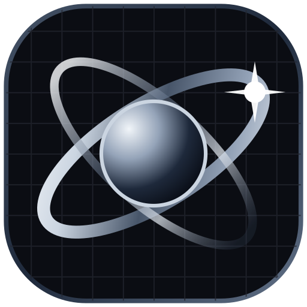
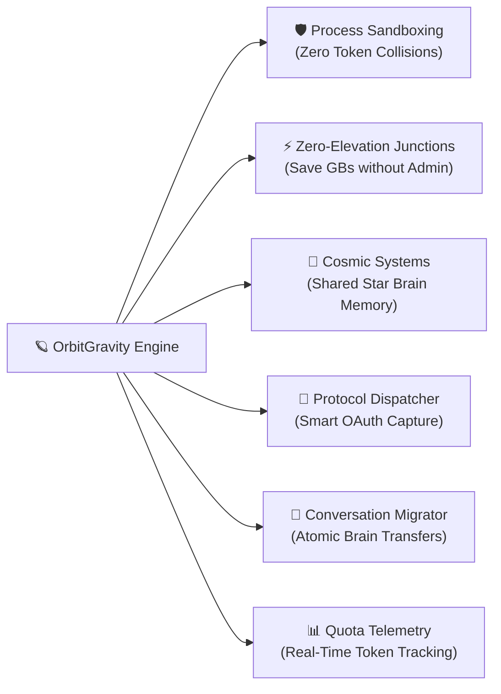

# OrbitGravity 🪐⚡

<div align="center">



### **Antigravity Mission Control for Windows**
*Run, isolate, and orchestrate unlimited concurrent Google Antigravity & Antigravity IDE instances with zero administrative rights, shared extension junctions, and cosmic memory synchronization.*

[](https://microsoft.com)
[](https://www.rust-lang.org/)
[](https://tauri.app/)
[](https://react.dev/)
[](./INDEPTH_README.md)
[](LICENSE)

[**Quick Start**](#-quick-start) • [**Features**](#-key-features) • [**User Guide**](#-user-guide--how-to-use) • [**Caveats**](#-important-caveats--known-limitations) • [**Deep-Dive Docs**](./INDEPTH_README.md)

</div>

---

## 🌌 Overview

If you use **Google Antigravity** or **Antigravity IDE** for enterprise projects, client work, and personal development, you've likely encountered its core friction points:
- You cannot sign into multiple Google accounts concurrently without constantly logging out and re-authenticating.
- Opening a second workspace delegates to the existing running window because of Electron's single-instance lock.
- Creating symlinks on Windows fails unless you run as Administrator or enable Windows Developer Mode.
- Browser OAuth sign-in redirects (`antigravity://`) always hijack the default installation instead of the profile you are working in.

**OrbitGravity** is an open-source native Windows orchestrator that completely solves these limitations. It lets you create isolated, lightweight profile environments ("Planets"), organize them into synchronized memory clusters ("Solar Systems"), capture browser authentication redirects, and monitor account token quotas—all without ever asking for Administrator privileges.

---

## ✨ Key Features



### 1. 🛡️ True Process & Account Sandboxing
Run multiple Antigravity windows side-by-side with completely separate Google accounts. Each instance runs in an isolated directory sandbox (`data/`, `appdata/`, `extensions/`) with custom environment variables, ensuring cookies, credentials, and settings never leak.

### 2. ⚡ Zero-Elevation NTFS Directory Junctions
Unlike standard symbolic links that fail on Windows without UAC elevation, OrbitGravity leverages native **NTFS Directory Junctions** (`mklink /J`). 
- **`auth-only` mode**: Instantly shares your installed extensions, linters, and themes from your main installation while isolating authentication and workspace memory. Saves gigabytes of disk space per profile!
- **`full` mode**: Gives you a completely clean, isolated extensions folder for dedicated environments.

### 3. 🌌 Cosmic Systems (Star Brain & Black Hole)
Organize your workspace profiles into cosmic memory hierarchies:
- **The Black Hole (Singularity Root)**: Directly tether an instance to your global `%USERPROFILE%\.gemini` installation.
- **Solar Systems**: Group related instances (e.g. Frontend + Backend) to share a centralized **Star Brain** (`SharedBrains/<system>`), automatically syncing conversation histories and checkpoints.
- **Rogue Planets**: Standalone profiles with completely independent memory.

### 4. 🔀 Smart Protocol Dispatcher (OAuth Interception)
Never lose an authentication token again. OrbitGravity registers a silent Windows protocol handler (`HKCU:\Software\Classes`) that captures browser redirects from Google Sign-In and routes the authentication token directly to your active isolated profile window instead of the global application.

### 5. 🧠 Conversation Importer & Brain Migration
Transfer or clone conversation checkpoints, transcripts (`transcript.jsonl`), and prompt histories between any profile or the global Black Hole root. OrbitGravity updates the underlying SQLite databases (`state.vscdb` and `conversations.db`), rebuilds search indexes, and injects layouts automatically.

### 6. 📊 Real-Time Quota Telemetry & Gauges
Track your monthly token allowances, Request-per-Minute (RPM) limits, active IDE concurrent slots, and daily spend caps with automatic warning banners when nearing quota thresholds (>85%).

### 7. 🚀 Windows Desktop Shortcuts Hub
Generate one-click `.lnk` desktop and Start Menu shortcuts equipped with custom flags, environment variables, and the authentic application icon.

---

## 📖 User Guide — How to Use

### 1. Creating a New Instance
1. Click **"+ New Instance"** in the sidebar.
2. Enter an **Instance Name** (e.g., `Client-Acme` or `Personal-Dev`).
3. Select an **Account Profile** to link quota telemetry.
4. Choose an **Isolation Mode**:
   - **Auth-Only (Recommended)**: Shares your existing extensions via NTFS junctions to save disk space.
   - **Full Isolation**: Completely separate extensions folder.
5. Select a **Cosmic Sync Mode**:
   - **Solar System**: Add to a cluster to share a central Star Brain with sibling instances.
   - **Black Hole**: Tether directly to global Antigravity memory.
   - **Solo (Rogue Planet)**: Completely isolated memory.
6. Click **Create Instance**.

### 2. Launching & Working in an Instance
- Click the **"Launch"** button on any instance card.
- OrbitGravity configures the directories, bridges Windows shell folders (`Desktop`, `Documents`), and spawns the isolated Antigravity window.
- The status indicator turns green, displaying the active Windows process ID (PID).

### 3. Enabling OAuth Protocol Dispatching
If you need to sign into Google or install third-party plugins that require browser authentication:
1. Open the **Protocol Dispatcher** panel or toggle it on the instance card.
2. Click **"Enable Protocol Dispatcher"**.
3. When your browser completes the sign-in flow and asks to open Antigravity, the dispatcher automatically routes the token into your active profile.
4. *To revert back to default Windows settings at any time, click "Restore Original Protocols".*

### 4. Transferring or Importing Conversations
1. Click the **"Transfer Conversations"** or **"Nebula Archive"** button.
2. Select the **Source** (e.g. Global Black Hole or an existing instance).
3. Check the conversations you wish to migrate.
4. Select the **Destination Instance**.
5. Click **"Execute Transfer"**. The engine copies the transcripts, SQLite records, and UI layout tabs.

---

## ⚠️ Important Caveats & Known Limitations

Please review these key requirements before using OrbitGravity:

> [!IMPORTANT]
> **NTFS Filesystem Required for Junctions**  
> Zero-elevation Directory Junctions (`mklink /J`) are an exclusive feature of the Windows **NTFS** file system. If your Windows user profile or project directory is stored on an **exFAT** or **FAT32** drive (e.g., external USB flash drives), junction creation will not be supported (the app will fall back to a full folder copy).

> [!WARNING]
> **Close Instances Before Migrating Conversations**  
> Because Antigravity stores conversation layouts in SQLite databases (`state.vscdb`), SQLite places a write-lock on the file while the IDE is running. **Always close the destination instance before importing conversations into it** to avoid database lock errors.

> [!NOTE]
> **Mutual Exclusion on Shared Brains & The Black Hole**  
> To protect against database corruption and transcript overwrites:
> - You cannot run a **Black Hole tethered instance** while the main **Parent Antigravity app** is open.
> - Two instances in the same **Solar System** with the same app type cannot write to the same Star Brain simultaneously.

> [!TIP]
> **Emergency Protocol Restore Scripts**  
> If you ever uninstall OrbitGravity or wish to manually restore your Windows Registry protocol associations, run the included batch script in the project root:
> ```cmd
> restore_original_protocols.bat
> ```
> This immediately restores `antigravity://` and `antigravity-ide://` handlers back to their original executables.

---

## ⚡ Installation & Quick Start

### For Users (No Coding Required)

Choose any of the three distribution channels:

| Method | Best For | Description |
| :--- | :--- | :--- |
| **[One-Click Setup (`.exe`)](https://github.com/orbitgravity/orbitgravity/releases/latest)** | **Recommended** | Double-click installer. Installs to user space with **zero Administrator rights** and creates a Desktop shortcut automatically. |
| **[Portable Archive (`.zip`)](https://github.com/orbitgravity/orbitgravity/releases/latest)** | Zero-Install / USB | Standalone `OrbitGravity.exe`. Unzip and run from any folder or external drive. |
| **PowerShell One-Liner** | Terminal Users | Run in PowerShell: `irm https://raw.githubusercontent.com/orbitgravity/orbitgravity/main/scripts/install.ps1 \| iex` |

> [!NOTE]
> **Windows SmartScreen Notice**:  
> Because OrbitGravity is an open-source project without a paid corporate EV certificate, Microsoft Defender SmartScreen may display *"Windows protected your PC"*. Simply click **More info** → **Run anyway**. All source code is 100% open, verified, and passes 42 automated tests.

---

### For Developers (Building from Source)

#### Prerequisites
- **Windows 10 or 11** (64-bit)
- [Node.js 18+](https://nodejs.org/) (tested with v20 and v25)
- [Rust & Cargo](https://rustup.rs/) (stable toolchain)
- Google Antigravity or Antigravity IDE installed on your system

#### 1. Clone & Install
```powershell
git clone https://github.com/orbitgravity/orbitgravity.git
cd orbitgravity
npm install
```

#### 2. Run in Development Mode
To launch the native Windows desktop application with live reload:
```powershell
npm run tauri dev
```

#### 3. Build Production Installer & Release Assets
To compile the optimized release binary and package the one-click NSIS installer:
```powershell
powershell -ExecutionPolicy Bypass -File scripts/build-release.ps1
```
All release artifacts (One-Click Installer `.exe`, Portable `.zip`, and SHA256 checksums) will be generated inside `release/`.

---

## 🧪 Automated Testing

OrbitGravity includes an exhaustive Rust test suite covering process lifecycle, NTFS junctions, WScript COM automation, SQLite FTS indexing, and rollback protection:

```powershell
cargo test --manifest-path src-tauri/Cargo.toml
```

**All 35 test suites passing:**
```
running 35 tests
test test_antigravity_binary_detection ... ok
test test_junction_support ... ok
test test_junction_lifecycle ... ok
test test_shortcut_creation ... ok
test test_transfer_copies_complete_assets_including_db_and_fts_search ... ok
test test_atomic_sync_anti_rollback_protection_master_retains_25 ... ok
...
test result: ok. 35 passed; 0 failed; 0 ignored; finished in 10.66s
```

---

## 📚 Deep-Dive Architecture Documentation

For complete engineering specifications, memory topology diagrams, Win32 API internals, SQLite schemas, and concurrency state machines, read our internal engineering specification:

👉 [**Read the Exhaustive Technical Architecture Guide (INDEPTH_README.md)**](./INDEPTH_README.md)

---

## 📄 License

Distributed under the **MIT License**. See `LICENSE` for more information.
