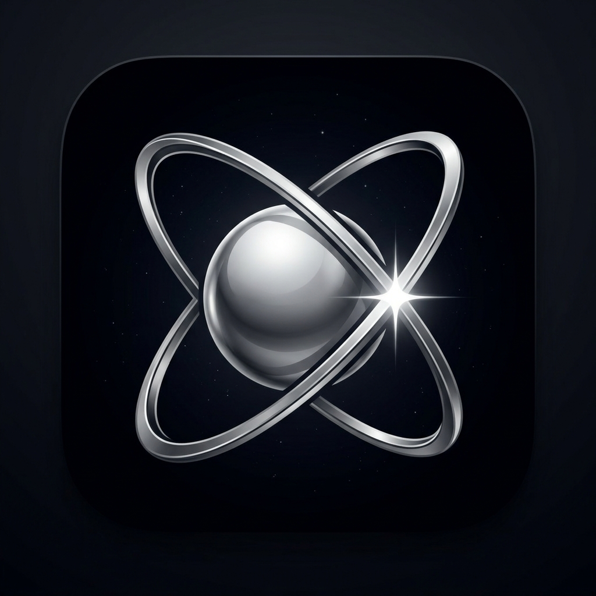
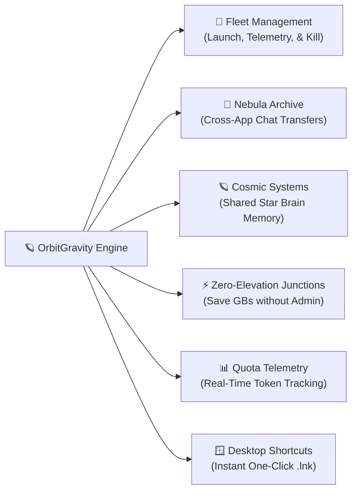

# OrbitGravity 🪐⚡

<div align="center">



### **Antigravity Mission Control for Windows**
*Run, isolate, and orchestrate unlimited concurrent Google Antigravity & Antigravity IDE instances with zero administrative rights, cross-instance conversation migrations, and cosmic memory synchronization.*

[](https://microsoft.com)
[](https://www.rust-lang.org/)
[](https://tauri.app/)
[](https://react.dev/)
[](./INDEPTH_README.md)
[](LICENSE)

[**Quick Start**](#-installation--quick-start) • [**Core Features**](#-core-selling-points) • [**User Guide**](#-user-guide--how-to-use) • [**Important Caveats**](#-important-caveats--known-limitations) • [**Deep-Dive Docs**](./INDEPTH_README.md)

</div>

---

## 🌌 Overview

If you use **Google Antigravity** or **Antigravity IDE** across multiple client projects, business accounts, or parallel AI workflows, you know the friction:
- You cannot sign into multiple Google accounts concurrently without constantly logging out and re-authenticating.
- Opening a second workspace delegates to the already-running window due to Electron's single-instance lock.
- Extension folders take up gigabytes of disk space if duplicated manually.
- Conversations, prompts, and agent checkpoints get permanently siloed inside separate installations.

**OrbitGravity** is an open-source native Windows orchestrator that solves this completely. It gives you a cockpit to spin up isolated profile environments ("Planets"), organize them into synchronized memory clusters ("Solar Systems"), search and transfer AI conversations across apps with zero data loss ("Nebula Archive"), and launch or terminate instances on demand—all with **zero administrative / UAC elevation**.

---

## ✨ Core Selling Points



### 1. 🚀 Fleet Management (Launch, Monitor & Terminate)
Run multiple independent Antigravity and Antigravity IDE instances side-by-side with complete sandbox isolation:
- **Instant Launch:** Spawns isolated windows with dedicated `--user-data-dir`, `--extensions-dir`, and independent profile directories.
- **Live Process Telemetry:** Real-time tracking of active Windows process IDs (PIDs), memory presence, and running states.
- **One-Click Termination:** Stop any active instance immediately from the dashboard with clean, graceful process tree shutdown. No zombie background processes.

### 2. 🌌 Nebula Archive (Cross-Instance Conversation Intelligence)
Never lose an AI session or insight again. Nebula Archive is a centralized memory browser that connects across your entire installation fleet:
- **Universal Conversation Search:** Instantly query conversation titles, prompts, and transcripts across all instances as well as your global Antigravity installation.
- **Zero-Loss Conversation Transfers:** Migrate full conversations from one instance to another (or from your global parent app into an isolated sandbox). OrbitGravity copies all transcripts (`transcript.jsonl`), updates SQLite records (`conversations.db` & `state.vscdb`), and rebuilds FTS5 search indexes automatically.
- **Deep JSONL Transcript Viewer:** Inspect conversation turns, reasoning steps, tool calls, and model metadata directly within the UI.
- **Export & Backup:** Create portable archive bundles to back up critical agent trajectories.

### 3. 🪐 Cosmic Systems (Solar Clusters & Shared Star Brains)
Organize your workspace profiles into connected memory hierarchies:
- **Solar Systems (Convergent Sync):** Group related instances (e.g. Frontend, Backend, and AI sub-agents) into a Solar System. Instances in the same cluster share a centralized **Star Brain** (`SharedBrains/<system>`), automatically synchronizing checkpoints and conversation histories.
- **The Black Hole (Singularity Anchor):** Tether any instance directly to your global `%USERPROFILE%\.gemini` installation for frictionless access to existing assets.
- **Rogue Planet Isolation & Solo Orbits:** Lock down sensitive or independent instances into dedicated solo orbits that are prevented from accidentally joining or colliding with group memory.

### 4. ⚡ Zero-Elevation NTFS Directory Junctions
Save gigabytes of storage across your instances without ever needing Administrator privileges:
- Unlike standard symlinks that require Windows Developer Mode or UAC elevation, OrbitGravity uses native **NTFS Directory Junctions** (`mklink /J`).
- **`Auth-Only` Mode (Recommended):** Shares your installed extensions, linters, and themes from your parent installation while keeping credentials, tokens, and workspace state completely isolated.
- **`Full Isolation` Mode:** Allocates an entirely independent extensions directory for completely air-gapped environments.

### 5. 📊 Real-Time Account Quota Telemetry
Monitor your token usage and rate limits at a glance:
- Real-time token usage meters and Requests-per-Minute (RPM) tracking.
- Pro and Ultra tier rate limit tracking with reset countdown timers.
- Visual badges styled with the sleek **Silver Cascade** finish.

### 6. 🪟 Windows Desktop Shortcuts Hub
Generate one-click `.lnk` desktop and Start Menu shortcuts for any instance:
- Pre-configured with exact sandbox arguments, environment variables, and the authentic application icon.
- Launch your dedicated client or project environments straight from your Windows desktop.

---

## 📖 User Guide — How to Use

### 1. Creating a New Instance
1. Click **"+ New Instance"** in the sidebar.
2. Enter an **Instance Name** (e.g., `Client-Acme` or `Backend-API`).
3. Select an **App Type**: Antigravity or Antigravity IDE.
4. Choose an **Isolation Mode**:
   - **Auth-Only (Recommended)**: Shares extensions via NTFS junctions to save disk space.
   - **Full Isolation**: Completely independent extensions folder.
5. Select a **System Architecture**:
   - **Solar System**: Add to an existing group or create a new cluster to share a central Star Brain.
   - **Solo Orbit (Rogue Planet)**: Keep memory strictly standalone and unjoined.
   - **The Black Hole**: Tether directly to global parent installation memory.
6. Click **Create Instance**.

### 2. Managing & Launching Your Fleet
- **Launch:** Click **"Launch"** on any instance card. OrbitGravity provisions folders, validates junctions, and opens the sandboxed window. The card displays a green indicator with the live Windows PID.
- **Terminate:** Click **"Terminate"** on any active instance to cleanly close its process tree.
- **Desktop Shortcut:** Click the shortcut button on any card to place a ready-to-run `.lnk` on your Windows desktop.

### 3. Migrating Conversations in Nebula Archive
1. Click the **"Nebula Archive"** tab in the top navigation.
2. Filter conversations by instance or view **All Fleet Conversations**.
3. Use the search bar to locate conversations by topic or query.
4. Click **"Transfer Conversations"**:
   - Select the **Source** (e.g., Global Black Hole or an existing instance).
   - Select the conversations to migrate.
   - Choose the **Destination Instance**.
   - Click **"Execute Transfer"**. The engine atomic-syncs transcripts, database records, and layouts.

### 4. Onboarding Tutorial
New to OrbitGravity's terminology? Click **Help > Tutorial** in the top navigation bar at any time to open the built-in 4-card interactive terminology guide.

---

## ⚠️ Important Caveats & Known Limitations

Please review these key requirements before using OrbitGravity:

> [!IMPORTANT]
> **NTFS Filesystem Required for Junctions**  
> Zero-elevation Directory Junctions (`mklink /J`) require the Windows **NTFS** file system. If your profile directory is located on an **exFAT** or **FAT32** drive (e.g., external USB flash drives), junctions cannot be created (OrbitGravity will fall back to an isolated folder copy).

> [!WARNING]
> **Close Instances Before Migrating Conversations**  
> Because Antigravity stores active session state in SQLite databases (`state.vscdb`), SQLite maintains a write-lock while the IDE is running. **Always ensure the destination instance is closed before executing a conversation transfer into it** to avoid database lock errors.

> [!NOTE]
> **Mutual Exclusion on Shared Brains & The Black Hole**  
> To protect against database corruption and simultaneous transcript collisions:
> - You cannot run a **Black Hole tethered instance** while the main **Parent Antigravity app** is open.
> - Two instances in the same **Solar System** with the same application type cannot write to the same Star Brain simultaneously.

---

## ⚡ Installation & Quick Start

### For Users (No Coding Required)

| Method | Best For | Description |
| :--- | :--- | :--- |
| **[One-Click Setup (`.exe`)](https://github.com/miguelistem/OrbitGravity/releases/latest)** | **Recommended** | Double-click installer. Installs to user space with **zero Administrator rights** and creates a Desktop shortcut automatically. |
| **[Portable Archive (`.zip`)](https://github.com/miguelistem/OrbitGravity/releases/latest)** | Zero-Install / USB | Standalone `OrbitGravity.exe`. Unzip and run from any folder or external drive. |
| **PowerShell One-Liner** | Terminal Users | Run in PowerShell: `irm https://github.com/miguelistem/OrbitGravity/releases/latest/download/install.ps1 \| iex` |

> [!NOTE]
> **Windows SmartScreen Notice**:  
> Because OrbitGravity is an open-source project without a paid corporate EV certificate, Microsoft Defender SmartScreen may display *"Windows protected your PC"*. Simply click **More info** → **Run anyway**. All source code is 100% open, verified, and passes 42 automated tests.

---

### For Developers (Building from Source)

#### Prerequisites
- **Windows 10 or 11** (64-bit)
- [Node.js 18+](https://nodejs.org/) (tested with v20 and v22)
- [Rust & Cargo](https://rustup.rs/) (stable toolchain)
- Google Antigravity or Antigravity IDE installed on your system

#### 1. Clone & Install
```powershell
git clone https://github.com/miguelistem/OrbitGravity.git
cd OrbitGravity
npm install
```

#### 2. Run in Development Mode
```powershell
npm run tauri dev
```

#### 3. Build Production Installer & Release Assets
```powershell
powershell -ExecutionPolicy Bypass -File scripts/build-release.ps1
```
All release artifacts (One-Click Installer `.exe`, Portable `.zip`, and SHA256 checksums) will be generated inside `release/`.

---

## 🧪 Automated Testing

OrbitGravity includes an exhaustive Rust test suite covering process lifecycle, NTFS junctions, conversation transfers, SQLite FTS indexing, and rollback protection:

```powershell
cargo test --manifest-path src-tauri/Cargo.toml
```

**All 42 test suites passing:**
```
running 42 tests
test test_duplicate_instance_name_rejected_case_insensitively ... ok
test test_is_parent_antigravity_process_filters_user_data_dir ... ok
test test_list_available_groups_aggregates_instances_and_disk_folders ... ok
test test_solar_system_star_naming_with_tags ... ok
test test_solo_orbit_group_collision_and_rogue_isolation ... ok
test test_concurrency_guard_mutual_exclusion ... ok
test test_junction_support ... ok
test test_antigravity_binary_detection ... ok
test test_junction_lifecycle ... ok
test test_atomic_sync_forward_upgrade_27_over_25 ... ok
test test_transfer_copies_complete_assets_including_db_and_fts_search ... ok
test test_instance_creation_and_deletion_lifecycle_with_file_verification ... ok
test test_solar_system_convergent_sync_propagates_to_all_members ... ok
test test_blackhole_attachment_and_detachment ... ok
...
test result: ok. 42 passed; 0 failed; 0 ignored; finished in 12.18s
```

---

## 📚 Deep-Dive Architecture Documentation

For complete engineering specifications, memory topology diagrams, Win32 API internals, SQLite schemas, and concurrency state machines, read our internal engineering specification:

👉 [**Read the Exhaustive Technical Architecture Guide (INDEPTH_README.md)**](./INDEPTH_README.md)

---

## 📄 License

Distributed under the **MIT License**. See `LICENSE` for more information.
