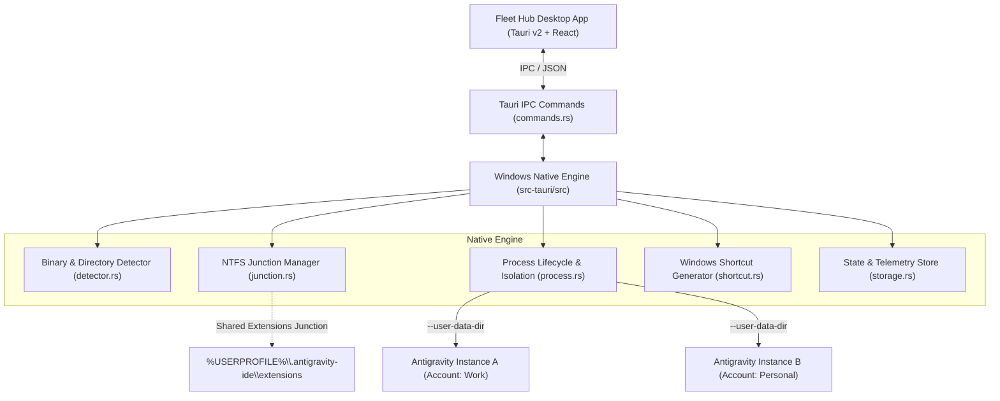

# Fleet Hub (BetterMultigravity) 🚀

> **Antigravity Mission Control for Windows** — Run and manage multiple isolated Google Antigravity instances concurrently, with zero-elevation NTFS Directory Junctions, real-time process monitoring, and local account quota telemetry.


---

## 🌟 Why BetterMultigravity?

| Problem in `multigravity-pro` | Solution in **Fleet Hub (BetterMultigravity)** |
| :--- | :--- |
| **Windows Symlinks fail without Admin** | Uses native **NTFS Directory Junctions** (`mklink /J`) for `--auth-only` profiles. Requires **zero Administrator privileges** or Developer Mode. |
| **Electron Single-Instance collision** | Launches processes with explicit `--user-data-dir` and `--extensions-dir` flags, guaranteeing clean window separation. |
| **Antigravity 2.0.1 IDE missed** | Auto-detects both classic `antigravity\Antigravity.exe` and split `Antigravity IDE\Antigravity IDE.exe`. |
| **No UI / purely CLI scripts** | Full **Tauri v2 + React + Tailwind CSS desktop app** with live gauges, status indicators, and 1-click launch. |
| **Self-update destroys Pro features** | Native compiled application with local state persistence in `%LOCALAPPDATA%\BetterMultigravity`. |
| **No Quota / Telemetry visibility** | Real-time tracking of token allowances, request rate (RPM) ceilings, daily spend caps, and active IDE limits. |

---

## 🛠️ Architecture



---

## ⚡ Quick Start

### Prerequisites
- Windows 10/11
- Node.js 18+ (tested with v25)
- Rust toolchain (`rustc` & `cargo`)
- Google Antigravity or Antigravity IDE installed

### Run Development App
```powershell
# 1. Install dependencies
npm install

# 2. Run in browser preview mode (with simulated mock IPC)
npm run dev

# 3. Run native Windows Tauri desktop app
npm run tauri dev
```

### Build Production Windows Binary
```powershell
npm run tauri build
```
Generates a standalone, lightweight `.exe` inside `src-tauri/target/release/`.

---

## 🧪 Testing

The Rust backend includes a dedicated automated test suite:

```powershell
cargo test --test backend_tests --manifest-path src-tauri/Cargo.toml
```

**Verified Test Suite (9/9 passing):**
- `test_antigravity_binary_detection`: Finds existing Antigravity installations.
- `test_junction_support`: Verifies non-admin NTFS Directory Junction capability.
- `test_junction_lifecycle`: Tests junction creation, traversal, and non-destructive unlinking.
- `test_profile_directory_setup`: Validates auth-only and full profile folder structures.
- `test_shortcut_creation`: Verifies Windows `.lnk` creation via WScript COM.
- `test_storage_saved_calculation`: Computes storage savings from junctioned extensions.
- `test_seed_data_and_stat_sync`: Verifies state synchronization and quota alert triggers.

---

## 📄 License
MIT License
